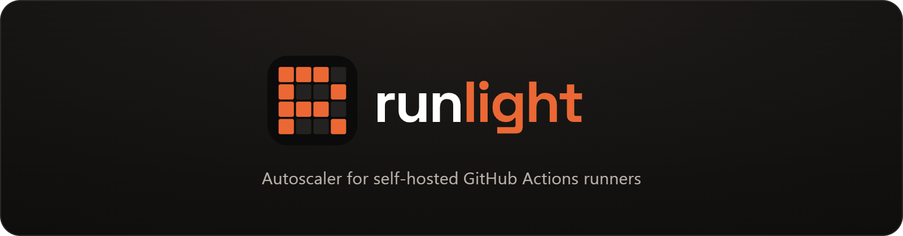

<p align="center">
  
</p>

<p align="center"><a href="README.md">English</a> · <b>Español</b></p>

**Autoscaler de runners self-hosted para GitHub Actions.**

Runlight arranca runners efímeros cuando hay jobs esperando y vuelve a cero cuando no. Vigila la presión sobre tus
servicios de producción para que el CI no los ahogue. Un binario Go pequeño, pensado para VPS compartidos.

## Características

- **Escala según demanda**: un runner por job, de 0 a N, con la API oficial de scale sets de GitHub (sin webhooks).
- **Consciente de producción**: frena si producción sufre presión de CPU, memoria o E/S (PSI).
- **Seguro**: nunca destruye un runner que está ejecutando un job; reiniciar el daemon no mata jobs.
- **Conserje de cachés**: mantiene a raya las cachés de build y el uso de disco.
- **Panel (PWA)**: vista en vivo, alertas, notificaciones push y ajustes editables sin reiniciar.
- **Backends**: `docker` o `systemd` nativo.

## Instalación

```bash
go build -trimpath -o runlight ./cmd/runlight
sudo install -m 0755 runlight /usr/local/bin/runlight
```

Pon tu configuración en `/etc/runlight/env` (modo `0600`):

```bash
RUNLIGHT_TOKEN=<token de GitHub>
RUNLIGHT_DASH_USER=admin
RUNLIGHT_DASH_PASSWORD_HASH=<salida de: runlight --hash-password>
RUNLIGHT_SESSION_KEY=<cadena aleatoria larga>
```

Copia `deploy/runlight.service` a `/etc/systemd/system/`, pon en `--url` tu org o repo y ejecuta:

```bash
sudo systemctl enable --now runlight
```

En un workflow se usa con `runs-on: runlight`. El panel escucha en `127.0.0.1:9128`; publícalo detrás de un proxy con HTTPS.
`runlight --help` lista todos los flags.

## Desarrollo

```bash
go vet ./... && go test ./...
cd internal/dashboard/web-src && npm ci && npm run build   # reconstruye el panel embebido
go run ./cmd/dashdemo --user admin --password demo-pass-123    # demo con datos de mentira
```

## Licencia

[MIT](LICENSE)
