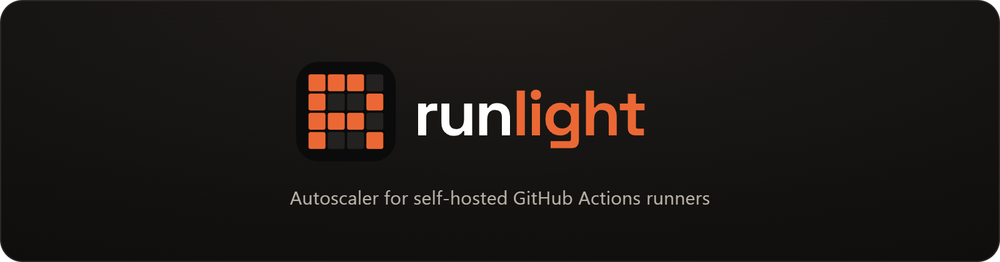

<p align="center">
  
</p>

<p align="center"><b>English</b> · <a href="README.es.md">Español</a></p>

**Autoscaler for self-hosted GitHub Actions runners.**

Runlight starts ephemeral runners when jobs are waiting and scales back to zero when they are not. It watches the
pressure on your production services, so CI never starves them. One small Go binary, built for shared VPS machines.

## Features

- **Scale on demand**: one runner per job, 0 to N, using the official GitHub scale sets API (no webhooks).
- **Production-aware**: backs off when production is under CPU, memory or I/O pressure (PSI).
- **Safe**: never destroys a runner that is running a job; restarting the daemon keeps jobs alive.
- **Cache janitor**: keeps build caches and disk usage under control.
- **Dashboard (PWA)**: live view, alerts, push notifications and settings you can change without a restart.
- **Backends**: `docker` or native `systemd`.

## Install

```bash
go build -trimpath -o runlight ./cmd/runlight
sudo install -m 0755 runlight /usr/local/bin/runlight
```

Put your settings in `/etc/runlight/env` (mode `0600`):

```bash
RUNLIGHT_TOKEN=<GitHub token>
RUNLIGHT_DASH_USER=admin
RUNLIGHT_DASH_PASSWORD_HASH=<output of: runlight --hash-password>
RUNLIGHT_SESSION_KEY=<long random string>
```

Copy `deploy/runlight.service` to `/etc/systemd/system/`, set `--url` to your org or repo, then:

```bash
sudo systemctl enable --now runlight
```

Use it in a workflow with `runs-on: runlight`. The dashboard listens on `127.0.0.1:9128`; put it behind an HTTPS proxy.
Run `runlight --help` for all flags.

## Development

```bash
go vet ./... && go test ./...
cd internal/dashboard/web-src && npm ci && npm run build   # rebuilds the embedded dashboard
go run ./cmd/dashdemo --user admin --password demo-pass-123    # demo with fake data
```

## License

[MIT](LICENSE)
